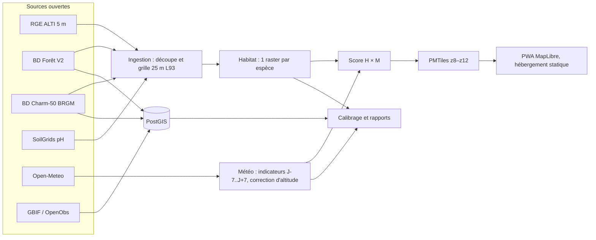

# PLAN — Prévision des zones de cueillette de champignons en Isère (38)

> Statut : **plan validé le 22/10/2026** (décisions ci-dessous).
> Les valeurs écologiques (§4) sont des **valeurs initiales d'expert**, validées pour être codées telles quelles, puis ajustées au calibrage (étape 5).

---

## 0. Décisions

| # | Décision | Retenu |
|---|----------|--------|
| D1 | Combinaison des facteurs (habitat et météo) | **Moyenne géométrique pondérée** (un facteur à 0 annule le score) |
| D2 | Fenêtre saisonnière par espèce intégrée au score météo | Oui : fenêtre large et fixe avec rampes de 15 j. L'altitude agit via la température corrigée |
| D3 | Fenêtres temporelles des indicateurs | Pluie : 15 j. Température moyenne, écart jour/nuit et gel : 7 j |
| D4 | Tables et seuils par espèce (§4) | **Validés tels quels**, ajustés au calibrage |
| D5 | Morille : BD Forêt n'identifie pas le frêne | **Deux profils** : plaine (ripisylves, alluvions) et montagne (conifères). H = max des deux (§4.6) |
| D6 | Maille d'échantillonnage Open-Meteo | 2,5 km (≈ 1 600 points, ≈ 3 500 appels/jour). Repli : 5 km |
| D7 | Usage Open-Meteo | **Non commercial** : API gratuite (10 000 appels/jour) |
| D8 | Zone de calibrage | Isère seule. Option : ajouter les départements limitrophes si les effectifs sont trop faibles |
| D9 | Fond de carte | Plan IGN v2 (WMTS Géoplateforme, Licence Ouverte) |
| D10 | Licence du code | À choisir avant le README final (MIT, Apache-2.0, AGPL…) |

---

## 1. Principe du modèle

```
score_final(x, d) = H_espèce(x) × M_espèce(x, d)        ∈ [0, 1]
```

- **H** (habitat) est statique et calculé une seule fois sur la maille de 25 m. Il combine essence forestière, nature géologique du substrat, pH, altitude, pente et exposition.
- **M** (météo) est recalculé chaque jour pour chaque date d ∈ [J-7, J+7] à partir des indicateurs météo corrigés par l'altitude, de la fenêtre saisonnière et d'une pénalité de gel.
- Le score est un **indice de favorabilité relative**, pas une probabilité de présence. L'interface l'affiche en 5 classes : très faible, faible, moyen, bon, très bon (seuils 0,2 / 0,4 / 0,6 / 0,8).

### 1.1 Fonctions élémentaires (définies dans le YAML)

| Type | Usage | Paramètres |
|------|-------|-----------|
| `table` | Variables catégorielles (essence, géologie, secteur d'exposition) | `valeurs: {classe: f}`, `defaut` |
| `trapeze` | Variables continues (altitude, pente, pH, pluie, température…) | `points: [a, b, c, d]`, `plancher` (valeur hors plage, 0 par défaut) |
| `paliers` | Comptages (jours de gel) | `{n_min: multiplicateur}` |
| `saison` | Jour de l'année | `debut`, `fin` (MM-JJ), `rampe_jours` |

### 1.2 Combinaison (D1)

```
H = masque_foret × exp( Σ wᵢ·ln fᵢ / Σ wᵢ )                       (moyenne géométrique pondérée)
M = saison(d) × exp( Σ wⱼ·ln gⱼ / Σ wⱼ ) × multiplicateur_gel
```

La moyenne géométrique pondérée est la méthode classique des modèles HSI (USFWS 1981). Elle conserve la logique du facteur limitant sans écraser le score lorsque plusieurs facteurs valent légèrement moins de 1. Un facteur peut être déclaré `bloquant: true` : s'il vaut 0, le score est 0. C'est le cas de l'essence forestière.

**Données manquantes** : un facteur sans donnée sur un pixel (pH absent en haute montagne, géologie non renseignée) est écarté, et les poids des autres facteurs sont renormalisés. Un facteur `bloquant` sans donnée annule le score.

---

## 2. Architecture



| Composant | Choix |
|-----------|-------|
| Stockage vecteur et tabulaire | PostGIS 16 (Docker) : limites, BD Forêt, géologie, observations, séries météo, métadonnées de run |
| Stockage raster | Fichiers COG GeoTIFF (EPSG:2154), plus adaptés aux rasters de 28 M px que PostGIS raster |
| Pipeline | Python ≥ 3.11, rasterio, geopandas/pyogrio, numpy, scipy, pydantic (validation YAML), httpx, argparse (CLI) |
| Tuiles | Raster PNG 8 bits paletté, EPSG:3857, PMTiles via `rio-pmtiles` (repli : MBTiles GDAL puis `pmtiles convert`) |
| Front | Vite + TypeScript sans framework, `maplibre-gl`, `pmtiles`, `vite-plugin-pwa` (Workbox) |
| Service local | Nginx (Docker), qui gère nativement les requêtes HTTP Range indispensables à PMTiles. Aucun backend applicatif |
| Orchestration | `Makefile` avec cibles fichiers. `make pipeline` déclenche l'ingestion et l'habitat seulement s'ils manquent |

### 2.1 Arborescence

```
mycologie/
├── PLAN.md  README.md  Makefile  docker-compose.yml  pyproject.toml
├── config/
│   ├── settings.yaml            # emprise, grille, URL des sources, Open-Meteo, gradient thermique, rétention
│   ├── classes/
│   │   ├── foret.yaml           # vocabulaire des classes d'essences et correspondance CODE_TFV
│   │   └── geologie.csv         # notation BRGM vers classe de substrat (relecture manuelle)
│   └── especes/                 # 1 fichier par espèce : ajouter une espèce = ajouter un fichier
│       ├── cepe.yaml  girolle.yaml  trompette.yaml  pied_de_mouton.yaml  morille.yaml
├── myco/                        # paquet Python
│   ├── grid.py  rules.py  habitat.py  score.py  tiles.py  calibrate.py  cli.py
│   ├── ingest/  (limite.py, rgealti.py, bdforet.py, geologie.py, soilgrids.py, observations.py)
│   └── meteo/   (fetch.py, fields.py, indicators.py)
├── db/init.sql
├── web/                         # PWA
├── tests/
├── reports/calibration/<espece>/
└── data/                        # ignoré par git
    ├── raw/<source>/            # téléchargements bruts + sha256
    ├── static/                  # alt, pente, expo, foret, geol, ph, masque (COG 25 m)
    ├── habitat/<espece>.tif
    └── runs/<AAAA-MM-JJ>/       # champs météo grossiers, scores 25 m temporaires
```

### 2.2 Cibles Make

| Cible | Rôle |
|-------|------|
| `make up` | Démarre PostGIS et Nginx |
| `make ingest` | Étape 2 : téléchargement, découpe et rééchantillonnage à 25 m |
| `make habitat` | Étape 3 : 1 raster H par espèce, plus PMTiles « habitat seul » |
| `make pipeline [DATE=AAAA-MM-JJ]` | Étapes 4 et 6 : météo, score, PMTiles et `latest.json` du jour |
| `make calibrate` | Étape 5 : rapports de calibrage |
| `make web` / `make serve` | Build de la PWA et service statique |
| `make test` / `make lint` | pytest et ruff |

---

## 3. Données

### 3.1 Sources, licences et attributions

| Donnée | Usage | Accès | Licence | Attribution affichée |
|--------|-------|-------|---------|----------------------|
| RGE ALTI® 5 m (IGN), dalles D038 | Altitude, pente, exposition | geoservices.ign.fr/rgealti | Licence Ouverte Etalab 2.0 | © IGN – RGE ALTI® |
| BD Forêt® V2 (IGN), D038 | Essences forestières | geoservices.ign.fr/bdforet | Licence Ouverte Etalab 2.0 | © IGN – BD Forêt® V2 |
| ADMIN EXPRESS (IGN) | Limite du département | WFS data.geopf.fr | Licence Ouverte Etalab 2.0 | © IGN – ADMIN EXPRESS |
| Plan IGN v2 | Fond de carte | WMTS data.geopf.fr | Licence Ouverte Etalab 2.0 | © IGN – Plan IGN |
| BD Charm-50 (BRGM), carte harmonisée D038 | Substrat calcaire / siliceux | infoterre.brgm.fr | Licence Ouverte (à confirmer, étape 2) | © BRGM |
| SoilGrids 2.0 (ISRIC), `phh2o` 0–30 cm | pH (indicateur secondaire) | WCS maps.isric.org | CC BY 4.0 | ISRIC – SoilGrids |
| Open-Meteo (Forecast et Historical API) | Météo J-22..J+7 et rétro-analyse | api.open-meteo.com, archive-api.open-meteo.com | Données CC BY 4.0 | Weather data by Open-Meteo.com (Météo-France, ECMWF, DWD) |
| GBIF | Observations (calibrage) | api.gbif.org, téléchargement avec DOI | Filtre **CC0 et CC BY uniquement** | GBIF.org + DOI du téléchargement |
| INPN / OpenObs (MNHN) | Observations (calibrage) | openobs.mnhn.fr (API, sinon export) | À confirmer (étape 2) | INPN / OpenObs – PatriNat |
| TAXREF (MNHN) | Résolution des noms de taxons | taxref.mnhn.fr | Licence Ouverte | TAXREF – MNHN |

La PWA affiche ces attributions dans le contrôle d'attribution MapLibre et sur une page « Sources et licences ». Le contenu de cette page est généré depuis `settings.yaml`.

### 3.2 Grille de référence

- **EPSG:2154 (Lambert-93), pas de 25 m**, origine calée sur un multiple de 25 m. L'emprise couvre le département plus un tampon de 1 km. Le masque restreint ensuite les calculs au département.
- Aucune sortie sous 25 m. Les entrées plus fines sont **agrégées** : le RGE ALTI 5 m est moyenné par blocs de 5 × 5 pixels. Les entrées plus grossières (SoilGrids à 250 m, champs météo à 2,5 km) sont interpolées de façon lisse sur la grille, et le poids de SoilGrids reste faible.
- Rastérisation des vecteurs : centre du pixel. L'unité minimale de BD Forêt (0,5 ha) et la précision de la carte au 1/50 000 restent compatibles avec 25 m.
- Tuiles : zoom maximal natif **z12** (≈ 27 m/px à 45° N). Aucune tuile z13 et plus n'est produite : MapLibre sur-zoome au-delà.

### 3.3 Couches statiques (`data/static/`, COG, 25 m)

| Fichier | Type | Contenu |
|---------|------|---------|
| `masque.tif` | uint8 | 1 = département |
| `alt.tif` | float32 | Altitude (m), moyenne 5 × 5 du RGE ALTI 5 m |
| `pente.tif` | uint8 | Pente (°), Horn sur `alt.tif` |
| `expo.tif` | uint8 | Secteur 0–7 (N, NE…, NO), 8 = plat (pente < 3°) |
| `foret.tif` | uint8 | Code de classe d'essence (`config/classes/foret.yaml`) |
| `geol.tif` | uint8 | Classe de substrat (`config/classes/geologie.csv`) |
| `ph.tif` | uint8 | pH × 10, moyenne pondérée 0–5, 5–15 et 15–30 cm, interpolation bilinéaire |

**Classes d'essences** (correspondance des codes `CODE_TFV` de BD Forêt V2 à vérifier à l'étape 2) : chênes décidus, hêtre, châtaignier, robinier, autres feuillus (purs ou en îlots), mélange de feuillus, peupleraie, sapin ou épicéa (**ces deux essences ne sont pas distinguées dans BD Forêt V2**), pin sylvestre, autres pins (noir, à crochets, cembro), mélèze, douglas, mélange de conifères, mixte à feuillus prépondérants, mixte à conifères prépondérants, forêt ouverte (feuillus, conifères ou mixte), lande ligneuse, formation herbacée.

**Classes de substrat** : la correspondance est semi-automatique (mots-clés sur la notation et la description BRGM), puis consignée dans un CSV que vous relirez.

| Classe | Exemples en Isère |
|--------|-------------------|
| `calcaire` | Calcaires urgoniens et tithoniques, dolomies, éboulis calcaires (Vercors, Chartreuse) |
| `marno_calcaire` | Marnes, marno-calcaires, flysch carbonaté (Trièves, piémonts) |
| `siliceux` | Granites, gneiss, micaschistes, schistes cristallins, grès siliceux (Belledonne, Oisans, Taillefer) |
| `detritique_mixte` | Moraines, molasses, colluvions et terrasses anciennes de composition variable (Bas-Dauphiné, Terres Froides) |
| `alluvions_recentes` | Alluvions fluviatiles récentes (Isère, Drac, Romanche, Rhône) |
| `indetermine` | Aucune correspondance fiable |

### 3.4 Schéma PostGIS (`db/init.sql`)

```sql
CREATE SCHEMA ref;  CREATE SCHEMA obs;  CREATE SCHEMA meteo;  CREATE SCHEMA pipeline;

ref.departement   (code text PK, nom text, geom geometry(MultiPolygon,2154))
ref.bdforet       (id text PK, code_tfv text, tfv text, essence text, classe text, geom geometry(MultiPolygon,2154))
ref.geologie      (id serial PK, notation text, descr text, lithologie text, classe text, geom geometry(MultiPolygon,2154))
ref.source        (id text PK, nom text, url text, licence text, attribution text, version text,
                   telecharge_le timestamptz, sha256 text)

obs.taxon         (espece text, nom_scientifique text, gbif_key int, cd_ref int, PRIMARY KEY (espece, nom_scientifique))
obs.observation   (id bigserial PK, source text CHECK (source IN ('gbif','inpn')), source_id text,
                   espece text, nom_scientifique text, date_obs date, incertitude_m real,
                   licence text, jeu_donnees text, doublon_de bigint NULL,
                   geom geometry(Point,2154), UNIQUE (source, source_id))

meteo.point       (id int PK, geom geometry(Point,2154), z_ref real)        -- grille d'échantillonnage
meteo.journalier  (run date, point_id int REFERENCES meteo.point, jour date,
                   tmin real, tmax real, tmoy real, pluie real, est_prevision bool, modele text,
                   PRIMARY KEY (run, point_id, jour))

pipeline.run      (run date PK, debut timestamptz, fin timestamptz, statut text,
                   config_sha text, code_version text, message text)
pipeline.calibrage(run date, espece text, metrique text, valeur real, details jsonb,
                   PRIMARY KEY (run, espece, metrique))
```

Les index GiST portent sur toutes les géométries. Les rasters restent hors base, mais leurs chemins et sha256 sont tracés dans `pipeline.run.message` (jsonb si nécessaire).

### 3.5 Sorties publiées (statiques)

```
web/data/
├── latest.json                         # run courant, dates, espèces, légende, sources
├── departement.geojson                 # contour du département (WGS84, simplifié)
├── habitat/<espece>.pmtiles            # habitat seul (statique)
└── runs/<AAAA-MM-JJ>/<espece>/<date>.pmtiles   # 5 espèces × 15 dates
```

`latest.json` est généré depuis les YAML. Le front ne connaît pas la liste des espèces en dur : ajouter un YAML suffit. Les 3 derniers runs sont conservés par défaut. `web/data` n'est pas copié dans le build : le serveur statique le sert sous `/data/`, ce qui permet de publier les cartes du jour sans reconstruire l'application.

---

## 4. Règles écologiques par espèce (à relire)

Niveaux de confiance : **E** = élevée (bien documentée), **M** = moyenne, **F** = faible (hypothèse de travail).
Les références numérotées renvoient au §8. Les **seuils chiffrés sont des propositions** fondées sur la littérature générale et le savoir naturaliste. Les références documentent les tendances (hôtes, substrat, rôle de la pluie et de la température), pas ces valeurs exactes.

Taxons regroupés (résolus via GBIF et TAXREF à l'étape 5) :

| Espèce | Taxons inclus |
|--------|---------------|
| Cèpe | *Boletus edulis*, *B. pinophilus*, *B. aereus*, *B. reticulatus* (= *B. aestivalis*) |
| Girolle | *Cantharellus cibarius* s.l. (option : *C. pallens*, *C. subpallidus*) |
| Trompette de la mort | *Craterellus cornucopioides* |
| Pied-de-mouton | *Hydnum repandum* (option : *H. rufescens*) |
| Morille | *Morchella* spp. (genre entier, la taxonomie étant instable) |

### 4.1 Habitat : essence forestière (facteur `bloquant`, poids 3)

La colonne Morille correspond au profil **plaine**. Le profil montagne est décrit au §4.6.

| Classe BD Forêt | Cèpe | Girolle | Trompette | Pied-de-mouton | Morille |
|-----------------|:---:|:---:|:---:|:---:|:---:|
| Hêtre | 1.0 | 1.0 | 1.0 | 1.0 | 0.3 |
| Chênes décidus | 0.9 | 0.9 | 0.8 | 0.9 | 0.4 |
| Châtaignier | 0.9 | 0.9 | 0.5 | 0.7 | 0.2 |
| Robinier | 0.1 | 0.1 | 0.1 | 0.2 | 0.3 |
| Autres feuillus | 0.6 | 0.6 | 0.7 | 0.7 | 0.8 |
| Mélange de feuillus | 0.8 | 0.8 | 0.9 | 0.9 | 0.7 |
| Peupleraie | 0.0 | 0.0 | 0.1 | 0.1 | 0.8 |
| Sapin ou épicéa | 0.9 | 0.8 | 0.4 | 0.9 | 0.1 |
| Pin sylvestre | 0.8 | 0.7 | 0.1 | 0.6 | 0.1 |
| Autres pins | 0.5 | 0.4 | 0.0 | 0.5 | 0.1 |
| Mélèze | 0.3 | 0.3 | 0.0 | 0.4 | 0.1 |
| Douglas | 0.4 | 0.4 | 0.1 | 0.4 | 0.1 |
| Mélange de conifères | 0.7 | 0.6 | 0.2 | 0.8 | 0.1 |
| Mixte à feuillus prépondérants | 1.0 | 0.9 | 0.9 | 1.0 | 0.4 |
| Mixte à conifères prépondérants | 0.9 | 0.8 | 0.6 | 1.0 | 0.2 |
| Forêt ouverte (feuillus, conifères, mixte) | 0.5 | 0.5 | 0.3 | 0.5 | 0.6 |
| Lande ligneuse | 0.1 | 0.1 | 0.0 | 0.1 | 0.1 |
| Formation herbacée, hors forêt | 0 | 0 | 0 | 0 | 0 |
| **Confiance** | E | E | E | M | **F** |
| **Sources** | [1][2][3] | [1][2][4] | [1][2] | [1][2] | [1][5][6] |

Notes :
- **Cèpe** : *B. edulis* et *B. pinophilus* sont associés au hêtre, à l'épicéa, au sapin et aux pins. *B. aereus* et *B. reticulatus* sont associés aux chênes et au châtaignier, en situation plus thermophile [3].
- **Girolle** : espèce acidophile, ectomycorhizienne des feuillus et des conifères [4].
- **Trompette** : hêtraies et chênaies sur sols frais, argileux, à humus de type mull [1][2].
- **Morille** : ripisylves (frênes, ormes, peupliers), anciens vergers, sols perturbés ou brûlés [5][6]. Ni le frêne ni les vergers ne sont identifiables dans BD Forêt, d'où le profil plaine fondé sur les alluvions récentes et la faible pente. Le groupe *M. elata* fructifie aussi sous conifères de montagne, ce que couvre le profil montagne (§4.6).

### 4.2 Habitat : substrat géologique (critère principal du sol, poids 2)

| Classe | Cèpe | Girolle | Trompette | Pied-de-mouton | Morille |
|--------|:---:|:---:|:---:|:---:|:---:|
| siliceux | 1.0 | 1.0 | 0.6 | 0.8 | 0.3 |
| detritique_mixte | 0.9 | 0.8 | 0.8 | 0.9 | 0.6 |
| marno_calcaire | 0.7 | 0.4 | 1.0 | 1.0 | 0.8 |
| calcaire | 0.6 | 0.3 | 1.0 | 1.0 | 0.8 |
| alluvions_recentes | 0.4 | 0.3 | 0.6 | 0.6 | 1.0 |
| indetermine | 0.7 | 0.6 | 0.7 | 0.8 | 0.6 |
| **Confiance** | M | E | M | M | F |

Limite connue : la roche mère ne détermine pas entièrement le sol. Sur les plateaux calcaires, les sols peuvent être décarbonatés et acides. Le pH SoilGrids sert de correctif secondaire.

### 4.3 Habitat : pH SoilGrids (trapèze, poids 0,5, plancher entre parenthèses)

| Cèpe | Girolle | Trompette | Pied-de-mouton | Morille |
|---|---|---|---|---|
| 4,0 / 4,5 / 6,5 / 7,5 (0,4) | 3,5 / 4,0 / 5,5 / 6,8 (0,3) | 4,5 / 5,5 / 7,5 / 8,3 (0,4) | 4,0 / 5,0 / 8,0 / 8,5 (0,5) | 5,5 / 6,5 / 8,0 / 8,5 (0,3) |

Confiance M. Le plancher et le poids faible tiennent compte de la résolution de 250 m et de l'incertitude des prédictions SoilGrids [15].

### 4.4 Habitat : relief

| Facteur (poids) | Cèpe | Girolle | Trompette | Pied-de-mouton | Morille |
|---|---|---|---|---|---|
| Altitude (m), trapèze (1) | 100 / 300 / 1700 / 2100 | 100 / 300 / 1600 / 2000 | 100 / 250 / 1300 / 1600 | 100 / 250 / 1700 / 2000 | 100 / 200 / 800 / 1200 |
| Pente (°), trapèze (1), plancher 0,3 | 0 / 0 / 25 / 45 | 0 / 0 / 30 / 45 | 0 / 0 / 35 / 50 | 0 / 0 / 30 / 45 | 0 / 0 / 10 / 30 (plancher 0,2) |
| Exposition, table (0,5) | neutre (non utilisée) | N, NE : 1 · E, NO : 0,9 · O, SE : 0,8 · S, SO : 0,7 | N, NE : 1 · NO : 0,9 · E : 0,8 · O : 0,7 · SE : 0,6 · S, SO : 0,5 | neutre | neutre |
| Confiance | M | M | M | M | F |

Le premier point d'altitude est à 100 m (décision du 23/10/2026), sous le point bas mesuré du département (129 m). L'altitude reste volontairement large, car l'effet thermique de l'altitude est déjà porté par la température corrigée (§4.5). Cela limite le double comptage. L'exposition ne traduit ici que le régime hydrique (versants nord plus frais) : son effet thermique saisonnier n'est pas modélisé dans le MVP.

Précisions validées le 23/10/2026 :
- Le terrain plat (pente < 3°) est neutre (1) pour l'exposition.
- Dans un facteur `table`, une classe non listée prend la valeur `defaut` (0). Exemple : douglas et lande dans le profil montagne de la morille.
- Au-delà du dernier seuil de pluie, la valeur est 0,5 (`plancher_haut`) pour toutes les espèces.

### 4.5 Météo (D2, D3)

Indicateurs calculés pour chaque date d et chaque pixel (§5.2) :

| Indicateur | Définition |
|------------|-----------|
| `pluie_15j` | Cumul des précipitations de d-14 à d (mm) |
| `tmoy_7j` | Moyenne de la température moyenne journalière de d-6 à d (°C), corrigée de l'altitude |
| `amplitude_7j` | Moyenne de (Tmax − Tmin) de d-6 à d (°C) |
| `gel_7j` | Nombre de jours avec Tmin corrigée < 0 °C entre d-6 et d |

| Paramètre | Cèpe | Girolle | Trompette | Pied-de-mouton | Morille |
|---|---|---|---|---|---|
| Saison (rampe 15 j) | 01-06 → 15-11 | 15-05 → 15-11 | 01-08 → 15-12 | 01-08 → 31-12 | 01-03 → 15-06 |
| `pluie_15j` trapèze (poids 3, 0,5 au-delà) | 20 / 50 / 150 / 300 | 15 / 40 / 150 / 300 | 25 / 60 / 200 / 350 | 20 / 50 / 200 / 350 | 15 / 30 / 120 / 250 |
| `tmoy_7j` trapèze (poids 2) | 8 / 12 / 20 / 25 | 9 / 13 / 22 / 27 | 5 / 9 / 17 / 22 | 2 / 6 / 15 / 20 | 6 / 9 / 15 / 20 |
| `amplitude_7j` trapèze (poids 1, plancher 0,5) | 4 / 8 / 14 / 20 | non utilisée | non utilisée | non utilisée | 4 / 8 / 15 / 20 |
| `gel_7j` multiplicateur | 0 j : 1 · 1–2 j : 0,5 · ≥ 3 j : 0,1 | 0 j : 1 · 1–2 j : 0,5 · ≥ 3 j : 0,1 | 0 j : 1 · 1–2 j : 0,7 · ≥ 3 j : 0,3 | 0 j : 1 · 1–2 j : 0,8 · ≥ 3 j : 0,5 | 0 j : 1 · 1–2 j : 0,7 · ≥ 3 j : 0,3 |
| Confiance | M | M | F–M | F–M | F |
| Sources | [7][8][9][10][11] | [4][7][9] | [1][2][9] | [1][2][9] | [5][6] |

Justifications :
- La pluie des 2 à 3 semaines précédentes est le premier déterminant de la fructification. La température module son effet [9][10][11].
- Le cèpe répond au contraste thermique après une période chaude et pluvieuse (« choc thermique » des naturalistes), d'où l'usage de l'amplitude.
- Le pied-de-mouton et la trompette sont tardifs et tolèrent les gelées légères.
- La morille réagit au réchauffement printanier du sol [5].

**Hors MVP** (extensions possibles par simple ajout au YAML et au code d'indicateurs) : humidité du sol et hauteur de neige Open-Meteo, noyau de pondération de la pluie (décalage de 7 à 10 jours), correction radiative selon l'exposition.

### 4.6 Morille : deux profils d'habitat (D5)

Le fichier YAML de la morille remplace `habitat.facteurs` par `habitat.profils`. Chaque profil a ses propres facteurs, et H est le maximum des profils (`combinaison_profils: max`). La météo est commune aux deux profils : la température corrigée retarde naturellement la saison en altitude.

| Facteur | Profil plaine (ripisylves, *M. esculenta*) | Profil montagne (conifères, groupe *M. elata*) |
|---------|--------------------------------------------|-----------------------------------------------|
| Essence (bloquant, poids 3) | Colonne Morille du §4.1 | Sapin ou épicéa 0,8 · mélèze 0,8 · mélange de conifères 0,7 · mixte à conifères prépondérants 0,7 · mixte à feuillus prépondérants 0,5 · hêtre 0,3 · pin sylvestre et autres pins 0,3 · forêt ouverte 0,5 · feuillus et peupleraie 0,1 |
| Substrat (poids 2) | Colonne Morille du §4.2 | Calcaire 0,9 · marno-calcaire 0,9 · détritique mixte 0,8 · alluvions récentes 0,6 · siliceux 0,5 · indéterminé 0,6 |
| pH (poids 0,5) | 5,5 / 6,5 / 8,0 / 8,5 (plancher 0,3) | 5,0 / 6,0 / 8,0 / 8,5 (plancher 0,4) |
| Altitude (poids 1) | 100 / 200 / 800 / 1200 | 700 / 900 / 1700 / 2000 |
| Pente (poids 1) | 0 / 0 / 10 / 30 (plancher 0,2) | 0 / 0 / 25 / 40 (plancher 0,3) |
| Confiance | F | F |

### 4.7 Exemple de fichier espèce (`config/especes/cepe.yaml`)

```yaml
id: cepe
nom: Cèpe
taxons: [Boletus edulis, Boletus pinophilus, Boletus aereus, Boletus reticulatus]
avertissement: null                 # ex. morille : « toxique crue ou insuffisamment cuite »
habitat:
  combinaison: moyenne_geometrique
  facteurs:
    essence:   {couche: foret, type: table, poids: 3, bloquant: true, defaut: 0,
                valeurs: {hetre: 1.0, chenes_decidus: 0.9, chataignier: 0.9, sapin_epicea: 0.9, ...}}
    substrat:  {couche: geol, type: table, poids: 2,
                valeurs: {siliceux: 1.0, detritique_mixte: 0.9, marno_calcaire: 0.7, calcaire: 0.6,
                          alluvions_recentes: 0.4, indetermine: 0.7}}
    ph:        {couche: ph, type: trapeze, poids: 0.5, points: [4.0, 4.5, 6.5, 7.5], plancher: 0.4}
    altitude:  {couche: alt, type: trapeze, poids: 1, points: [150, 300, 1700, 2100]}
    pente:     {couche: pente, type: trapeze, poids: 1, points: [0, 0, 25, 45], plancher: 0.3}
meteo:
  saison: {debut: "06-01", fin: "11-15", rampe_jours: 15}
  combinaison: moyenne_geometrique
  indicateurs:
    pluie_15j:    {type: trapeze, poids: 3, points: [20, 50, 150, 300], plancher_haut: 0.5}
    tmoy_7j:      {type: trapeze, poids: 2, points: [8, 12, 20, 25]}
    amplitude_7j: {type: trapeze, poids: 1, points: [4, 8, 14, 20], plancher: 0.5}
  gel: {seuil_tmin: 0, fenetre_jours: 7, paliers: {1: 0.5, 3: 0.1}}
sources: ["Courtecuisse & Duhem", "Hall et al. 1998", "Martínez de Aragón et al. 2007"]
```

Un schéma pydantic valide chaque YAML (couches existantes, classes connues, points croissants, poids positifs). Le code ne contient aucune règle propre à une espèce.

---

## 5. Pipeline détaillé

### 5.1 Étape 2 : ingestion

1. Récupérer la limite du 38 (WFS ADMIN EXPRESS), puis construire la grille de 25 m et `masque.tif`.
2. RGE ALTI 5 m : l'archive D038 est trouvée dans le flux Atom du service de téléchargement de la Géoplateforme. On en tire la mosaïque, la découpe et la moyenne 5 × 5 vers `alt.tif`, puis la pente et l'exposition.
3. BD Forêt V2 : lecture WFS (Géoplateforme) sur l'emprise de la grille, chargement dans PostGIS, attribution de la classe d'essence, rastérisation vers `foret.tif`. Les codes rencontrés sont listés dans `reports/ingestion/foret_codes.csv`.
4. BD Charm-50 (D038) : chargement dans PostGIS, classification semi-automatique, export de `geologie.csv` **pour relecture**, puis `geol.tif`.
5. SoilGrids `phh2o` (WCS, Homolosine) : découpe, reprojection, moyenne pondérée des profondeurs, interpolation bilinéaire vers `ph.tif`.
6. Traçabilité : chaque téléchargement est enregistré dans `ref.source` (URL, version, date, sha256). Les téléchargements sont idempotents et les reprises sur erreur gérées.

### 5.2 Étape 4 : météo et correction d'altitude

1. **Échantillonnage** : grille régulière L93 de 2,5 km sur le département plus un tampon de 5 km, soit ≈ 1 600 points.
2. **Requête Open-Meteo Forecast** : `start_date` = J-21 (J-7 moins la fenêtre de pluie de 15 jours) et `end_date` = J+7, soit 29 jours. Variables journalières : `temperature_2m_min`, `temperature_2m_max`, `temperature_2m_mean` et `precipitation_sum`, avec `models=best_match`. Les points sont regroupés par lots de 100. Les requêtes sont espacées pour rester sous 500 appels/min, et chaque lot est mis en cache. `z_ref` est l'altitude qu'Open-Meteo renvoie pour chaque point, celle à laquelle il a ramené sa température. Les résultats vont dans `meteo.journalier`.
3. **Retrait de la tendance altitudinale** : T₀ = T + γ·z_ref, avec γ = 0,65 °C/100 m. Un gradient mensuel est optionnel (cf. [16] pour sa variabilité saisonnière dans les Alpes).
4. **Interpolation** : les champs T₀, la pluie et l'amplitude, connus sur la grille régulière de 2,5 km, sont rééchantillonnés vers 25 m par une B-spline cubique (GDAL `cubicspline`), ce qui donne un rendu lisse sans carrés de 1 km. Cette spline lisse légèrement les extrêmes locaux. Les cellules sans point en bordure prennent la valeur du point le plus proche. La pluie est bornée à ≥ 0.
5. **Réapplication de la tendance à 25 m** : T(x) = T₀(x) − γ·z(x), avec z issu de `alt.tif`.
   - `tmoy_7j(x) = T₀moy_7j(x) − γ·z(x)` : l'opération est linéaire, donc on la calcule sur la grille grossière puis on la réapplique.
   - `gel_7j(x) = Σ_d [ z(x) > z₀,d(x) ]`, où z₀,d = Tmin₀,d / γ est l'altitude de l'isotherme 0 °C du jour d. Seuls 7 champs grossiers sont nécessaires par date.
   - `amplitude_7j` ne dépend pas de γ. Limite connue : les inversions nocturnes de fond de vallée (Grésivaudan, Trièves) ne sont pas représentées.
6. Seuls les champs grossiers sont stockés (quelques Mo par run). Le calcul à 25 m se fait par blocs, au moment du score.

### 5.3 Score et tuilage

- Pour chaque espèce et chaque date de J-7 à J+7 : S = H × M, codé en uint8 (0–100, 255 = nodata), puis reprojeté en EPSG:3857 au plus proche voisin, colorisé en 5 classes (PNG 8 bits, transparent quand S = 0) et écrit en PMTiles z8–z12.
- Les dates à partir du jour de récupération sont marquées « prévision » dans `latest.json`, les dates antérieures « analyse ».
- La fenêtre saisonnière vaut 0 au premier et au dernier jour, et monte ou descend linéairement sur `rampe_jours` à l'intérieur de la fenêtre. Hors saison, la carte est vide : son fichier PMTiles ne contient qu'une tuile transparente.
- Une écriture atomique (répertoire temporaire puis renommage) garantit que `latest.json` ne pointe jamais vers un run incomplet.

### 5.4 Étape 5 : calibrage

1. **Observations** :
   - GBIF : téléchargement avec DOI, compte en `.env`, repli sur l'API de recherche. Filtres : `coordinateUncertaintyInMeters ≤ 100`, pas d'anomalie géographique, licences CC0 ou CC BY, années ≥ 2005.
   - OpenObs : mêmes filtres, en excluant les données floutées à la commune ou à la maille.
   - Dédoublonnage GBIF / INPN (même taxon, même date, distance < 50 m).
2. **Habitat** : valeurs de H aux présences, comparées à un fond de 10 000 points tirés parmi **toutes les observations de champignons** de la zone (fond « target-group », pour corriger le biais d'accessibilité [13]). Métriques :
   - indice de Boyce continu [12] ;
   - AUC présences / fond ;
   - ratio « % d'observations / % de surface » par classe de H ;
   - répartition observée et attendue par essence et par substrat.
3. **Météo** : rétro-analyse via l'Historical API d'Open-Meteo (ERA5-Land, ≈ 9 km), avec la même correction d'altitude. M le jour de l'observation est comparé à M aux autres jours de la saison au même point. Métriques :
   - AUC temporelle ;
   - histogramme phénologique (observations par quinzaine, comparé à la fenêtre saisonnière).
   Cache par (cellule ERA5-Land, année). Budget estimé entre 10 000 et 30 000 appels, étalé sur plusieurs jours (repli : ERA5-Land via Copernicus CDS).
4. **Rapport** `reports/calibration/<espece>/rapport.md` avec figures PNG : effectifs et filtres, métriques, graphiques, et **liste des règles contredites par les données**, par exemple plus de 20 % des observations dans une classe valant ≤ 0,3. Les YAML ne sont **pas ajustés automatiquement** : vous décidez des corrections.

Biais connus : observations concentrées près des routes et des villes, effectifs faibles pour la morille, différence de résolution entre ERA5-Land (rétro-analyse) et les prévisions.

---

## 6. PWA (étape 6)

| Fonction | Mise en œuvre |
|----------|---------------|
| Carte | MapLibre GL JS. Fond Plan IGN v2 (WMTS en XYZ), couche raster PMTiles (`maxzoom: 12`, sur-zoom au-delà), emprise limitée au 38 |
| Sélecteur d'espèce | Construit depuis `latest.json`, sans liste en dur |
| Curseur de date | J-7 à J+7. Libellé « analyse » ou « prévision », date du run affichée |
| Légende | 5 classes et couleurs, avec la mention « indice de favorabilité, pas une garantie de présence » |
| Habitat seul | Bascule optionnelle vers `habitat/<espece>.pmtiles` |
| Sources et licences | Contrôle d'attribution MapLibre, replié par défaut sur mobile, limité aux sources visibles sur la carte. La liste complète (licence, attribution, lien) figure dans la page « À propos » |
| Avertissement au premier lancement | Fenêtre modale bloquante avec case « J'ai compris ». L'acceptation est mémorisée en `localStorage` et l'avertissement reste consultable depuis « À propos » |
| Installation | `manifest.webmanifest` (icônes 192 et 512, maskable, `display: standalone`) et service worker. HTTPS requis hors localhost |
| Hors ligne | Voir ci-dessous |
| Exclusions | **Aucune identification** : ni photo, ni description morphologique, ni comparateur d'espèces. Seuls les noms des espèces apparaissent |

**Hors ligne** (dernière carte consultée) :
- Le shell applicatif est précaché par Workbox, et `latest.json` est servi en *network-first*.
- À chaque affichage d'une combinaison espèce et date, le fichier PMTiles complet (2 à 5 Mo) est téléchargé en arrière-plan dans un cache `derniere-carte`, qui remplace la précédente. Le service worker répond ensuite aux requêtes Range depuis ce cache (`workbox-range-requests`).
- Les tuiles du fond Plan IGN sont mises en cache *cache-first* (expiration à 2 000 tuiles ou 30 jours).
- Hors ligne, un bandeau indique la date des données affichées.

**Texte d'avertissement (projet, à valider)** :
> Cette application indique des zones et périodes **potentiellement favorables**. Elle ne permet pas d'identifier un champignon. Ne consommez jamais un champignon dont l'identification n'est pas certaine : faites contrôler votre cueillette par un pharmacien ou une association mycologique. En cas de symptômes après consommation, appelez le 15 ou le centre antipoison. Respectez la réglementation locale (arrêtés municipaux et préfectoraux, propriétés privées, Parc national des Écrins et réserves naturelles), que l'application ne prend pas en compte.

---

## 7. Volumétrie estimée (maille de 25 m)

| Élément | Estimation |
|---------|-----------|
| Département | **Mesuré** : 7 869 km² (contour ADMIN EXPRESS), soit 12,59 M pixels de 625 m² |
| Emprise rectangulaire (+1 km) | **Mesuré** : 5 238 × 5 312 px, soit **27,8 M px** |
| Pixels forestiers (H > 0) | **Mesuré** : 40 % du département (classes forestières de BD Forêt), soit 5,07 M px |
| 1 couche de 28 M px, brute | uint8 ≈ 28 Mo · float32 ≈ 113 Mo |
| Téléchargements bruts (une fois) | **Mesuré** : archive RGE ALTI 5 m de 505 Mo (383 dalles, 2,6 Go une fois extraites) · BD Forêt 445 Mo (GeoPackage, 49 914 polygones) · BD Charm-50 à mesurer · SoilGrids lu à distance, **soit ≈ 3,5 Go** |
| Couches statiques (COG compressés) | ≈ 100–200 Mo |
| Habitat, 5 espèces (COG) | **Mesuré** : 3 à 4 Mo par espèce, soit ≈ 19 Mo |
| Champs météo grossiers par run | < 10 Mo (≈ 60 × 60 px × 30 jours × 4 variables) |
| Scores 25 m par run, 5 × 15 = 75 rasters | ≈ 2,1 Go bruts, ≈ 0,3–0,6 Go compressés. **Temporaires**, supprimés après tuilage (sauf `KEEP_RASTERS=1`) |
| Tuiles z8–z12 par PMTiles | **Mesuré** : ≈ 300 tuiles non vides, soit 1,2 à 1,7 Mo |
| PMTiles par run | **Mesuré** : 75 fichiers, **88 Mo** (+ habitat ≈ 7,5 Mo) |
| Rétention de 3 runs | ≈ 0,3 Go |
| PostGIS | BD Forêt ≈ 10⁵ polygones, géologie ≈ 10⁴, observations 10³–10⁴, météo ≈ 50 000 lignes par run, **soit < 1 Go** |
| Appels Open-Meteo par jour | **Mesuré** : 1 698 points × 2,07 (29 jours, 4 variables), soit ≈ 3 500 (≈ 900 avec une maille de 5 km) |
| Client hors ligne | Shell < 1 Mo + 1 PMTiles (2–5 Mo) + fond consulté (≤ 50 Mo) |
| Temps de calcul (conteneur 4 cœurs, 15 Go) | **Mesuré** : ingestion ≈ 10 min hors géologie · habitat ≈ 80 s · `make pipeline` ≈ 18 min (météo ≈ 8 min, limitée par le débit autorisé ; 75 cartes ≈ 10 min) · mémoire < 1,5 Go |

---

## 8. Références

1. Courtecuisse R., Duhem B. — *Guide des champignons de France et d'Europe*. Delachaux et Niestlé.
2. Eyssartier G., Roux P. — *Le guide des champignons France et Europe*. Belin.
3. Hall I.R., Lyon A.J.E., Wang Y., Sinclair L. (1998). Ectomycorrhizal fungi with edible fruiting bodies 2. *Boletus edulis*. *Economic Botany* 52(1): 44–56.
4. Danell E. (1999). *Cantharellus*. In : Cairney J.W.G., Chambers S.M. (éd.), *Ectomycorrhizal Fungi: Key Genera in Profile*. Springer.
5. Pilz D. et al. (2007). *Ecology and management of morels harvested from the forests of western North America*. USDA Forest Service, Gen. Tech. Rep. PNW-GTR-710.
6. Kuo M. (2005). *Morels*. University of Michigan Press.
7. Büntgen U., Kauserud H., Egli S. (2012). Linking climate variability to mushroom productivity and phenology. *Frontiers in Ecology and the Environment* 10(1): 14–19.
8. Kauserud H. et al. (2008). Mushroom fruiting and climate change. *PNAS* 105(10): 3811–3814.
9. Boddy L. et al. (2014). Climate variation effects on fungal fruiting. *Fungal Ecology* 10: 20–33.
10. Martínez de Aragón J., Bonet J.A., Fischer C.R., Colinas C. (2007). Productivity of ectomycorrhizal and selected edible saprotrophic fungi in pine forests of the pre-Pyrenees mountains, Spain. *Forest Ecology and Management* 252: 239–256.
11. Karavani A. et al. (2018). Effect of climatic and soil moisture conditions on mushroom productivity and related ecosystem services in Mediterranean pine stands facing climate change. *Agricultural and Forest Meteorology* 248: 432–440.
12. Hirzel A.H., Le Lay G., Helfer V., Randin C., Guisan A. (2006). Evaluating the ability of habitat suitability models to predict species presences. *Ecological Modelling* 199: 142–152.
13. Phillips S.J. et al. (2009). Sample selection bias and presence-only distribution models: implications for background and pseudo-absence data. *Ecological Applications* 19(1): 181–197.
14. U.S. Fish and Wildlife Service (1981). *Standards for the development of habitat suitability index models*. 103 ESM.
15. Poggio L. et al. (2021). SoilGrids 2.0: producing soil information for the globe with quantified spatial uncertainty. *SOIL* 7: 217–240.
16. Rolland C. (2003). Spatial and seasonal variations of air temperature lapse rates in Alpine regions. *Journal of Climate* 16(7): 1032–1046.

---

## 9. Feuille de route et points de validation

| Étape | Livrables | Validation attendue |
|-------|-----------|---------------------|
| 1. Plan | Ce document | Décisions D1–D10 et tables du §4 |
| 2. Ingestion | `make ingest`, couches statiques, `geologie.csv` et correspondance BD Forêt, tests | Relecture des classes de substrat et d'essences, aperçu des couches |
| 3. Habitat | Moteur de règles YAML, 5 rasters H, PMTiles « habitat seul » | Revue visuelle des cartes H par massif |
| 4. Météo | Récupération Open-Meteo, champs corrigés, indicateurs, `make pipeline` | Contrôle d'un profil de température vallée/sommet et d'une date de pluie connue |
| 5. Calibrage | 5 rapports | Arbitrage des ajustements des YAML |
| 6. PWA | Carte, sélecteurs, légende, avertissement, hors ligne, installation | Test sur mobile (Android et iOS) |
| Final | README (installation, exécution, ajout d'espèce, licences) | Critères de « done » |

**Tests** : pytest pour les fonctions de règles, l'alignement de grille, la correction d'altitude (cas analytiques), la validation des YAML et un mini-pipeline sur une emprise de 5 × 5 km. ruff pour le style.

## 10. Risques et limites

- Ancienneté de BD Forêt V2 : coupes et tempêtes postérieures non prises en compte. Sapin et épicéa confondus. Frêne absent.
- Le substrat géologique est une approximation du sol (§4.2).
- Gradient thermique constant : les inversions de vallée et l'effet orographique sur la pluie ne sont pas corrigés.
- Prévisions au-delà de J+3 de plus en plus incertaines : l'interface l'indique, sans quantification dans le MVP.
- Calibrage limité par des données de présence seule, biaisées et peu nombreuses pour certaines espèces.
- Conditions d'usage Open-Meteo (D7) et licence OpenObs à confirmer.
