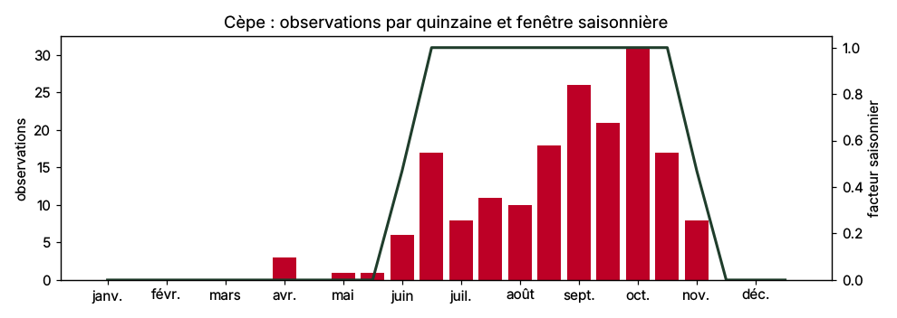
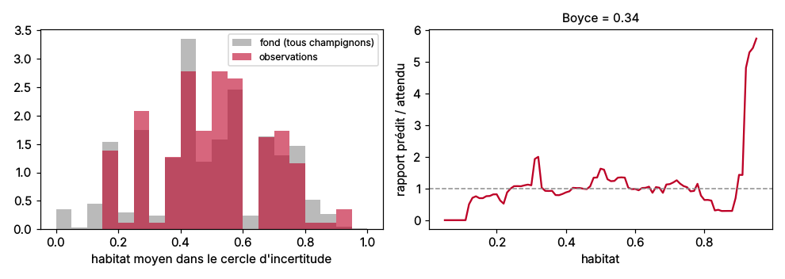
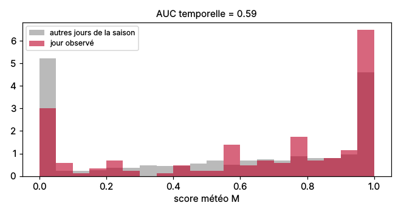

# Calibrage – Cèpe

Généré le 23/10/2026. Taxons : Boletus edulis, Boletus pinophilus, Boletus aereus, Boletus reticulatus.

> **Rapport de diagnostic.** Les règles de `config/especes/cepe.yaml` ne sont pas modifiées automatiquement.
> **Provisoire** : habitat calculé sans la carte géologique BRGM (serveur indisponible) : rapports à régénérer après son intégration.

## Données

| | Nombre |
|---|---:|
| Observations GBIF dans le département (≥ 2005, CC0 / CC BY) | 178 |
| … datées au jour près (phénologie) | 178 |
| … localisées à ≤ 3000 m (habitat, météo) | 173 |
| Fond « target-group » : observations de champignons localisées | 24163 |

Principaux jeux de données (GBIF) :

- 0155b886-98a0-4d3e-88b2-9fd0513e647e : 94
- 96cb0072-426e-4c30-875d-9201aecc15ff : 23
- 26dfdca2-d8a1-4135-a03a-b669b67eb187 : 12
- f1a66948-f513-4746-a8c5-f463c2eed067 : 9
- 130d809d-87a5-4d74-a113-0fbf30d33e45 : 8
- 088709e6-96bb-4b1a-89c7-835140735b3e : 5

Requête GBIF : https://api.gbif.org/v1/occurrence/search?hasCoordinate=true&hasGeospatialIssue=false&occurrenceStatus=PRESENT&decimalLatitude=44.6959,45.8834&decimalLongitude=4.7420,6.3593&year=2005,2026&license=CC0_1_0,CC_BY_4_0

## Phénologie

Observations hors de la fenêtre saisonnière du modèle : **3 %**.

## Habitat

L'habitat est moyenné dans le cercle d'incertitude de chaque observation, puis comparé au même calcul sur le fond.

- AUC observations / fond : 0.53 (faible)
- Indice de Boyce continu : 0.34 (faible)

### Composition : essences

Part moyenne de chaque classe dans les cercles (observations et fond), et valeur attribuée par la règle.

|  | valeur_regle | part_observations | part_fond | ratio |
|---|---|---|---|---|
| melange_feuillus | 0.80 | 0.41 | 0.37 | 1.11 |
| sapin_epicea | 0.90 | 0.27 | 0.27 | 0.99 |
| chataignier | 0.90 | 0.09 | 0.08 | 1.16 |
| mixte_feuillus | 1.00 | 0.07 | 0.07 | 0.99 |
| mixte_coniferes | 0.90 | 0.05 | 0.06 | 0.87 |
| chenes_decidus | 0.90 | 0.05 | 0.05 | 0.95 |
| foret_ouverte | 0.50 | 0.02 | 0.02 | 0.72 |
| hetre | 1.00 | 0.01 | 0.02 | 0.43 |
| autres_feuillus | 0.60 | 0.02 | 0.02 | 0.84 |
| pin_sylvestre | 0.80 | 0.00 | 0.01 | 0.21 |
| peupleraie | 0.00 | 0.00 | 0.01 | 0.31 |
| melange_coniferes | 0.70 | 0.00 | 0.01 | 0.54 |
| douglas | 0.40 | 0.01 | 0.00 | 1.46 |
| robinier | 0.10 | 0.00 | 0.00 | 1.50 |
| autres_pins | 0.50 | 0.00 | 0.00 | 0.36 |
| meleze | 0.30 | 0.00 | 0.00 | 0.00 |

## Météo à la date d'observation

Score M calculé avec la météo historique (Open-Meteo, ERA5-Land et ERA5), à l'altitude médiane des forêts du cercle, comparé aux autres jours de la saison au même endroit.

- AUC temporelle : 0.59 (faible)
- Sous-scores moyens le jour observé : pluie_15j 0.66, tmoy_7j 0.86, amplitude_7j 0.97, saison 0.95, gel 0.98

Valeurs des indicateurs les jours d'observation (déciles 10 et 90, médiane), comparées aux seuils du trapèze de la règle :

|  | seuils_regle | p10 | mediane | p90 | sous_score_moyen | jours_a_zero_pct |
|---|---|---|---|---|---|---|
| pluie_15j | 20 / 50 / 150 / 300 | 18.40 | 43.60 | 89.16 | 0.66 | 11.56 |
| tmoy_7j | 8 / 12 / 20 / 25 | 9.74 | 14.60 | 18.53 | 0.86 | 4.05 |
| amplitude_7j | 4 / 8 / 14 / 20 | 6.94 | 9.50 | 11.10 | 0.97 | 0.00 |

## Règles à revoir

- Habitat : AUC 0.53, le modèle distingue mal les zones observées du fond.
- Météo : AUC temporelle 0.59, les jours observés ne sont pas nettement mieux notés que les autres jours.
